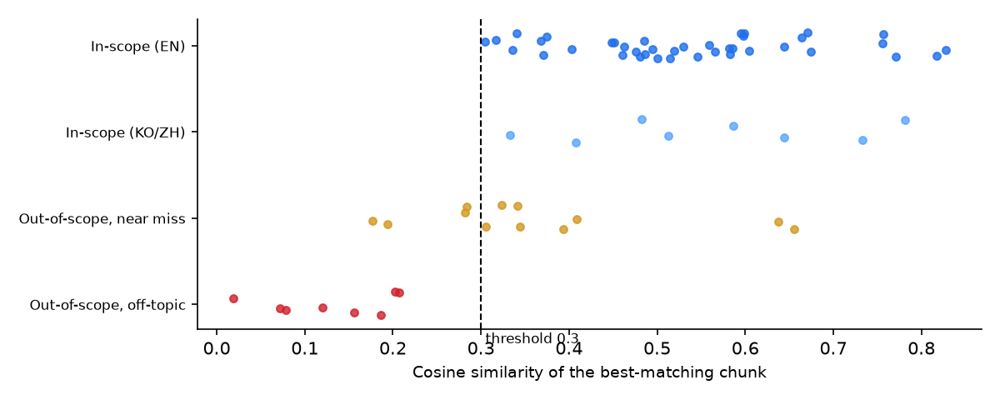

# RAG Lite: Retrieval-Augmented Q&A Backend with a Measured Relevance Threshold

A small retrieval-augmented generation (RAG) service written from scratch, without LangChain or LlamaIndex: document chunking, a FAISS vector index, a relevance threshold that refuses out-of-scope questions, and per-session chat memory, behind a FastAPI endpoint. Retrieval and the full pipeline are evaluated on 68 labelled questions in English, Korean and Chinese. Personal project, 2026.

<p align="center"></p>

**Stack:** Python · FastAPI · FAISS · Sentence-Transformers (multilingual MiniLM) · any OpenAI-compatible LLM API (default: Zhipu GLM-4-Flash, free tier) · pytest

## Problem

- An LLM asked about internal company documents will invent a plausible answer when the documents do not contain one.
- Long documents have to be cut into chunks for retrieval, and a fact that falls on a chunk boundary can become unretrievable.
- If retrieved text is saved into the chat history, it piles up turn after turn: prompts grow, and old context leaks into unrelated later questions.

## Method

```
handbook.md ─► split by section ─► sliding-window chunks ─► MiniLM embeddings ─► FAISS (inner product)
                                    (60 words, 15 overlap)    (L2-normalised)

question ─► embed ─► top-k search ─► best similarity < 0.30 ? ─► yes ─► fixed "not in the knowledge base" reply
                                                │                        (LLM is not called)
                                                no
                                                ▼
                         system prompt + clean history + [context + question] ─► LLM ─► answer + sources
```

| Component | File | What it does |
|---|---|---|
| Chunking | [`app/chunking.py`](app/chunking.py) | Splits the document by Markdown section, then into overlapping word windows. Chunks never span two sections, and each one is prefixed with its section title so the embedding knows the topic |
| Retrieval | [`app/retriever.py`](app/retriever.py) | Normalised embeddings in a FAISS inner-product index, so scores are cosine similarities (same ranking as L2 distance). Hits below the threshold are dropped |
| Fallback | [`app/main.py`](app/main.py) | If no chunk passes the threshold, the API returns a fixed reply **without calling the LLM**. If chunks do pass, the system prompt still tells the model to say it does not know when the context lacks the answer |
| Memory | [`app/memory.py`](app/memory.py) | Thread-safe per-session history, limited to the last 6 messages. Only the user's plain question is stored; retrieved context is attached to the outgoing copy of the message and never saved |
| API | `POST /chat`, `GET /health`, `DELETE /sessions/{id}` | Response includes the answer, a `fallback` flag and the source chunks with their scores |

The knowledge base is an invented employee handbook for a fictional robotics company ([`data/handbook.md`](data/handbook.md), 11 sections, about 1,000 words).

## Results

Retrieval only, so no API key is needed to reproduce these. Question set: [`eval/questions.json`](eval/questions.json): 40 English in-scope questions, 8 Korean and Chinese in-scope questions, 12 *near-miss* out-of-scope questions (on company topics the handbook does not cover, e.g. parental leave) and 8 off-topic ones. A retrieval counts as correct when a returned chunk contains the answer string. Full output: [`eval/results.md`](eval/results.md).

**Chunk overlap helps when chunks are small.**

| Chunk size (words) | Overlap | Recall@1 | Recall@3 | Korean/Chinese recall@3 |
|---:|---:|:---:|:---:|:---:|
| 30 | 0 | 0.70 | 0.82 | 0.75 |
| 30 | 10 | 0.80 | 0.95 | 1.00 |
| 60 | 0 | 0.68 | 0.88 | 1.00 |
| **60** | **15** | 0.78 | 0.93 | 1.00 |
| 120 | 0 | 0.82 | 0.95 | 1.00 |
| 120 | 30 | 0.82 | 0.95 | 1.00 |

With 30- and 60-word chunks, overlap raised recall@1 by about 10 points. With 120-word chunks it made no difference, because most handbook sections fit into one or two chunks. 60/15 is the default: recall close to the best, with prompts half the size of 120-word chunks.

**The threshold reliably rejects off-topic questions, but not near misses.**

| Threshold | In-scope answered | Korean/Chinese answered | Near-miss rejected | Off-topic rejected |
|---:|:---:|:---:|:---:|:---:|
| 0.20 | 1.00 | 1.00 | 0.17 | 0.75 |
| **0.30** | **1.00** | **1.00** | 0.33 | **1.00** |
| 0.35 | 0.90 | 0.88 | 0.67 | 1.00 |
| 0.45 | 0.78 | 0.75 | 0.83 | 1.00 |
| 0.60 | 0.25 | 0.38 | 0.83 | 1.00 |

- Off-topic questions all score below 0.21 and in-scope questions all score above 0.30, so a threshold of **0.30** separates them with no errors on this set.
- Near-miss questions overlap with in-scope ones (0.18 to 0.66). "How long is parental leave?" scores 0.64 against the annual-leave section, higher than most real questions. No single threshold removes them without also rejecting valid questions: 0.45 rejects 83 % of near misses but also 22 % of in-scope questions.
- So the design uses two layers: the threshold blocks clearly unrelated questions before any LLM call, and near misses that pass it reach an LLM that is instructed to answer only from the retrieved context. The end-to-end results below test the second layer.
- The multilingual embedding model retrieves the English handbook from Korean and Chinese questions with recall@3 of 1.00 (8 questions).

The threshold was chosen on the same small question set it is reported on, so these numbers are optimistic; a held-out set would be needed for a fair estimate.

### End to end, with the LLM

Same 68 questions through the full pipeline, with the same prompt as the API (GLM-4-Flash, top-3 chunks). Every answer is listed in [`eval/end_to_end.md`](eval/end_to_end.md); the automatic check (does the answer contain the expected fact, allowing for Korean or Chinese phrasing) agreed with a manual review of all failures.

| Question group | Result |
|---|:---:|
| In-scope (English): correct answer | 37/40 |
| In-scope (Korean/Chinese): correct answer, in the question's language | 8/8 |
| Near miss: declined ("I don't know" or fallback) | **12/12** |
| Off-topic: declined (all by the threshold, without an LLM call) | **8/8** |

- **No made-up answers to out-of-scope questions.** The 8 near misses that passed the threshold, including "How long is parental leave?", were all answered with "I don't know". The two-layer design works on this set.
- **All 3 in-scope failures come from retrieval, not generation.** Two answers needed facts that were not in the top 3 chunks, and the model correctly said it did not know. The third is the one real error: for "Can I carry unused vacation days into next year?" the retrieved chunk contained only "remaining days expire on 31 March" but not the 5-day carry-over limit, so the model answered "No". A partial chunk can be worse than no chunk, which is an argument for retrieving whole sections or adding a re-ranker.

## Run it

Python 3.10+.

```bash
pip install -r requirements.txt
python -m eval.eval_retrieval          # retrieval evaluation, no API key needed
pytest                                 # unit and API tests (fake model and LLM)

cp .env.example .env                   # add LLM_API_KEY for the chat endpoint
python -m eval.eval_end_to_end        # end-to-end evaluation (about 2 minutes)
uvicorn app.main:app                   # then open index.html in a browser
```

```bash
curl -X POST http://127.0.0.1:8000/chat -H "Content-Type: application/json" \
     -d '{"question": "What is the daily meal allowance on a business trip?", "session_id": "demo"}'
```

## Limitations

- 68 questions on one invented document is a small test; the numbers show the method works, not how it would do on real company data.
- The index is rebuilt in memory at start-up and sessions live in process memory, so this is a single-process demo, not a production service.
- Pure vector search can miss exact identifiers (names, codes); hybrid search with BM25 and a re-ranker would be the next step.

## How this was built

- Feb–Mar 2026: original design and first implementation, written by me.
- Oct 2026: revised with Claude Code as an AI pair programmer: English rewrite,
  refactoring, unit tests, a measured relevance threshold, and end-to-end tests. These commits are marked
  as co-authored.

---
Code: [MIT](LICENSE). The handbook is invented sample data.
